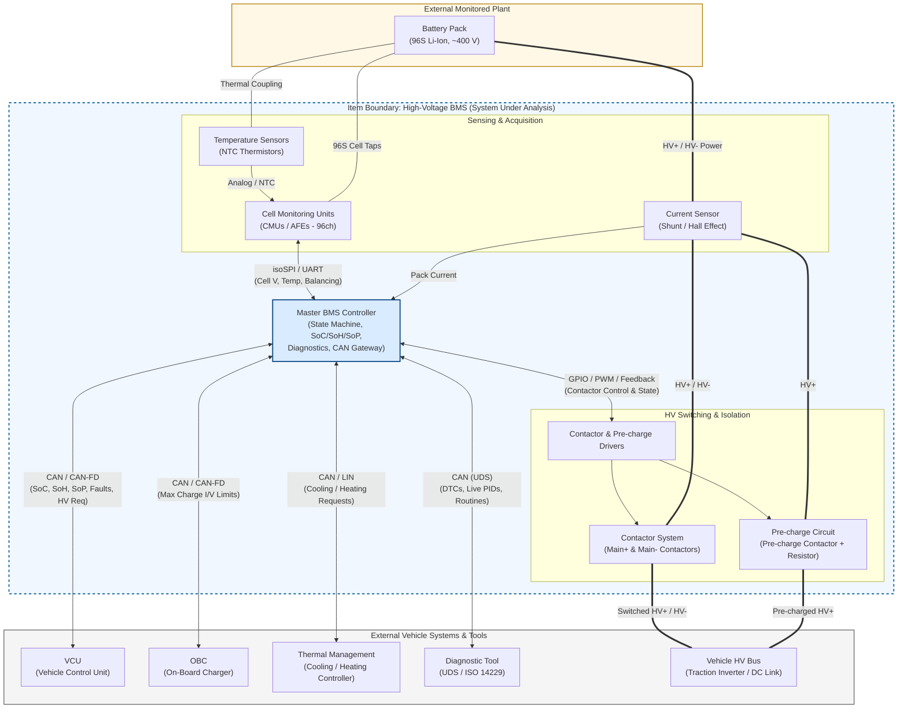

# 01 Item Definition — High-Voltage Battery Management System (BMS)

## 1. Document Purpose & Standard Reference
This document establishes the **Item Definition** in accordance with **ISO 26262-3 (Concept Phase)**. It defines the system under consideration, its functional purpose, system boundaries, internal and external interfaces, operational modes, and operating environment as the baseline for the Hazard Analysis and Risk Assessment (HARA) and Functional Safety Concept (FSC).

---

## 2. Item Identification & Purpose
* **Item Name:** High-Voltage Battery Management System (HV-BMS)
* **Target Application:** 400 V Battery Electric Vehicle (BEV) Passenger Car
* **Nominal System Voltage:** ~350–400 V DC (96S Lithium-Ion configuration, ~288 V min to ~403 V max)
* **Primary Functional Purpose:**
  * Continuously monitor cell voltages, module temperatures, and pack current to keep the lithium-ion battery within its Safe Operating Area (SOA).
  * Estimate internal battery states including State of Charge (SoC), State of Health (SoH), and State of Power (SoP).
  * Control High-Voltage (HV) galvanic isolation via main contactors and manage DC-link pre-charge sequencing.
  * Coordinate cell balancing, thermal conditioning requests, and dynamic charge/discharge power limits with host vehicle controllers.
  * Detect electrical, thermal, and hardware faults and transition the battery system to a defined safe state.

---

## 3. System Boundary & Component Allocation

### 3.1 Item Boundary Block Diagram

### 3.2 Boundary Definition
* **Inside Item Boundary (System Under Analysis):**
  * Master BMS Controller (hardware & embedded application software)
  * Cell Monitoring Units (CMUs / Slave AFEs) and internal daisy-chain/isolated communication bus
  * Pack Current Sensor and Temperature Sensors (NTC thermistors)
  * Contactor Driver stages, HV Contactor System (Main Positive, Main Negative), and Pre-charge Circuit (Pre-charge Contactor + Resistor)
  * High-Voltage Interlock Loop (HVIL) sensing and Insulation Monitoring Device (IMD) interface
* **Outside Item Boundary (External Environment & Interacting Systems):**
  * Electro-chemical battery cells (96S Lithium-Ion Battery Pack)
  * Vehicle Control Unit (VCU) and Traction Inverter
  * On-Board Charger (OBC) and DC Fast Charging interface
  * Thermal Management System (Battery Cooling/Heating Controller, pumps, chillers, PTC heaters)
  * 12 V Low-Voltage (LV) vehicle power supply and external UDS Diagnostic Tool

### 3.3 Component Breakdown

| Component | Boundary Location | Description & Functional Role |
| :--- | :--- | :--- |
| **Battery Pack** | External (Monitored Plant) | 96-series-cell (96S) lithium-ion battery pack (~400 V nominal) storing and supplying electrical energy. |
| **Master BMS** | Inside Item | Central battery management controller executing state machines, estimation algorithms, power limit calculations, diagnostics, and CAN communication. |
| **Cell Monitoring Unit** | Inside Item | Distributed Analog Front-End (AFE) slave boards measuring individual cell voltages (96 channels) and controlling passive balancing switches. |
| **Temperature Sensors** | Inside Item | Distributed NTC thermistors placed across battery modules and busbars to monitor battery temperature. |
| **Current Sensor** | Inside Item | Bidirectional shunt or Hall-effect sensor measuring total pack charge and discharge current. |
| **Contactor System** | Inside Item | Electromechanical high-voltage switches (Main Positive and Main Negative contactors) with auxiliary/voltage feedback controlling HV galvanic isolation. |
| **Pre-charge Circuit** | Inside Item | Pre-charge contactor and current-limiting resistor controlling gradual DC-link capacitor charging prior to main contactor closure. |
| **VCU** | External System | Vehicle-level control unit managing propulsion torque requests, vehicle mode coordination, and HV-enable commands. |
| **OBC** | External System | On-board charger converting AC grid power to DC to charge the HV battery pack within BMS-commanded limits. |
| **Thermal Management** | External System | Vehicle thermal controller managing coolant pumps, valves, chiller, and battery heaters based on BMS thermal requests. |

---

## 4. Interfaces

### 4.1 External & Subsystem Interfaces

| Interface | Connected Elements | Protocol / Medium | Information Exchanged |
| :--- | :--- | :--- | :--- |
| **BMS – VCU** | Master BMS ↔ Vehicle Control Unit | Automotive CAN / CAN-FD | `BatterySoC`, `BatterySoH`, `MaxChargeCurrent` / `MaxDischargeCurrent` (SoP), `BatteryFaultStatus`, `ContactorState`, HV enable/shutdown requests. |
| **BMS – OBC** | Master BMS ↔ On-Board Charger | Automotive CAN / CAN-FD | `MaxChargeCurrent`, `MaxChargeVoltage`, charge enable/stop flags, charger status feedback. |
| **BMS – Thermal Controller** | Master BMS ↔ Thermal Management | Automotive CAN / LIN | Cooling/heating power requests, target coolant temperature, actual battery min/max/average temperatures. |
| **BMS – Cell Monitoring** | Master BMS ↔ Cell Monitoring Units (CMUs) | Isolated Daisy-Chain (isoSPI / UART) | Individual `CellVoltage` (96x), module `CellTemperature`, `CellBalancingCommand`, AFE diagnostic/CRC status. |
| **BMS – Contactor Driver** | Master BMS ↔ Contactor & Pre-charge Drivers | Discrete GPIO / PWM / High-Side & Low-Side Drivers | `ContactorControlRequest` (Main+, Main-, Pre-charge), coil current sense, auxiliary contact / HV voltage feedback (`ContactorState`). |
| **BMS – Diagnostic Tool** | Master BMS ↔ External Service Tester | CAN (UDS / ISO 14229) | Diagnostic Trouble Codes (DTCs), freeze-frame data, live measurement PIDs, routine control (e.g., contactor test, fault clear). |

### 4.2 Power & Physical Safety Interfaces
* **Low-Voltage (LV) Supply Interface:** 12 V DC vehicle battery input (KL30 permanent supply and KL15 wake-up ignition line).
* **High-Voltage (HV) Power Interface:** HV+ and HV- terminals connecting the 96S battery pack through the contactor system to the vehicle HV junction box / traction inverter / OBC.
* **HVIL Interface:** Series low-voltage continuity loop routed through HV connectors and service disconnect to detect physical HV connector unmating.

---

## 5. Operational Modes
The HV-BMS operates across eight defined system modes:

1. **Initialization:**
   * MCU boots from low-voltage wake-up, initializes hardware peripherals and RTOS tasks, loads non-volatile calibration and stored `BatterySoH`, and establishes internal communication with the Cell Monitoring Units.
2. **Standby:**
   * Startup self-tests and safety checks (HVIL, insulation resistance, contactor weld check) have passed. Main HV contactors remain open, power limits are set to `0 A`, and the BMS reports readiness to the VCU.
3. **Pre-charge:**
   * Upon VCU HV-enable request, the negative main contactor and pre-charge contactor close to safely charge the external DC-link capacitance until DC-link voltage matches `PackVoltage` within tolerance.
4. **Operating:**
   * Main positive and negative contactors are closed (`ContactorState = CLOSED`), pre-charge contactor is open, and the HV bus is energized. The BMS continuously publishes dynamic power limits (`SoP`) while awaiting charge or discharge demand.
5. **Charging:**
   * Active when connected to an external charger (OBC or DC charger) with VCU authorization. The BMS regulates `MaxChargeCurrent` based on cell voltage/temperature limits and activates cell balancing to equalize cell states.

6. **Discharging:**
   * Active during vehicle driving or accessory load operation. The BMS monitors high-rate discharge currents, updates `BatterySoC`, and enforces dynamic `MaxDischargeCurrent` limits to prevent cell undervoltage or overheating.
7. **Fault handling:**
   * Triggered upon detection and confirmation of a safety-relevant or critical operational fault (e.g., cell overvoltage, critical overtemperature, HVIL open, contactor weld, or VCU communication timeout). The BMS enforces safe-state actions including power derating to `0 A`, emergency contactor opening, DTC storage, and fault broadcasting.
8. **Shutdown:**
   * Triggered when the VCU de-asserts the HV-enable request. The BMS ramps current limits to `0 A`, opens main contactors at near-zero load current to prevent arcing, persists updated `SoC`/`SoH` and DTCs to non-volatile memory, and transitions to low-power sleep.

---

## 6. Operating Environment & Assumptions
* **Ambient Temperature Range:** -40 °C to +85 °C (under-hood / chassis-mounted automotive environment).
* **Electrical Environment:** 12 V nominal LV system (6 V to 16 V operating range per ISO 16750-2) and 400 V DC HV traction bus with galvanic isolation barrier (> 500 Ω/V per UN ECE R100).
* **Mechanical & Ingress Protection:** IP67 / IP6K9K sealed enclosure rated for automotive vibration and mechanical shock profiles.
* **Safe State Definition (ISO 26262):** Main HV contactors physically **OPEN** (galvanic isolation between the 96S battery pack and external vehicle HV bus) with current limits set to `0 A`.
